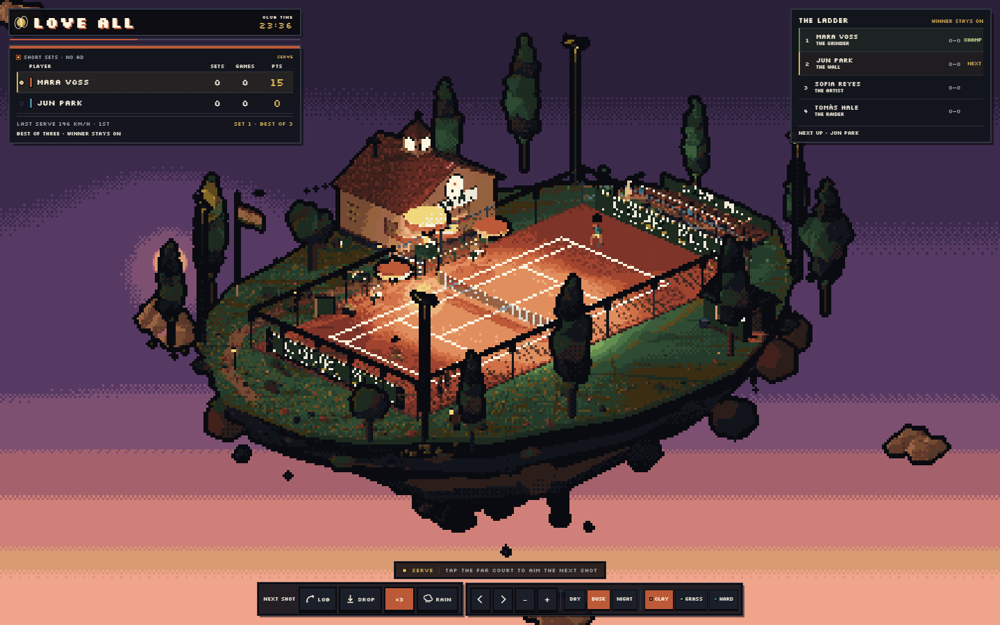
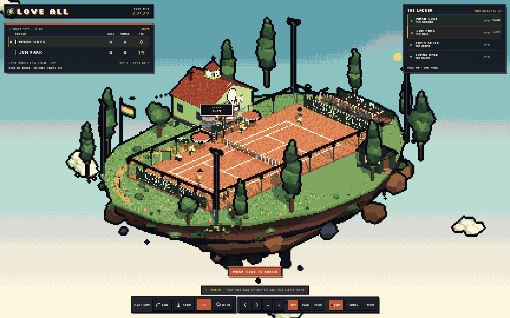
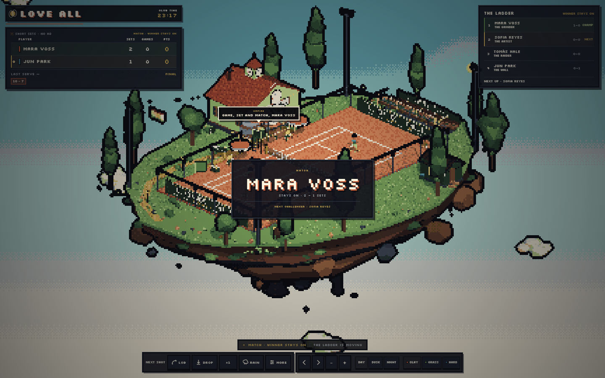
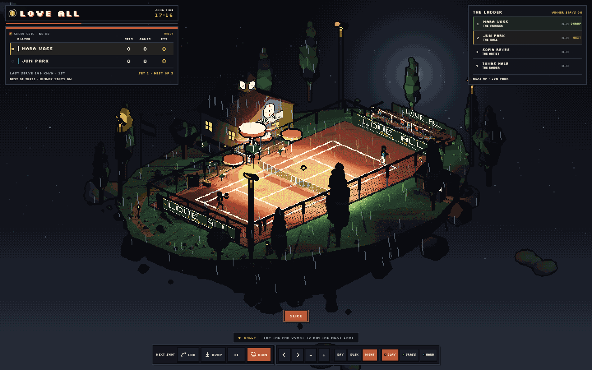
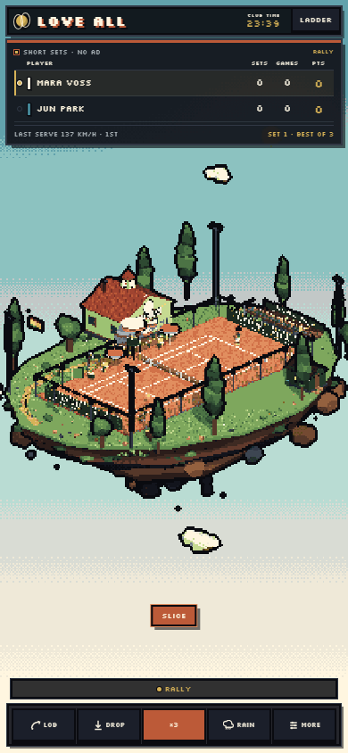

<div align="center">

# Love All

<p align="center">
<strong>SmallTennis</strong> — un club de tennis en pixel art, posé sur une île flottante.<br>
Simulation de tennis autonome, ladder « winner stays on », météo et surfaces, dans le navigateur.
</p>

[](https://jfoissac.github.io/SmallTennis/)
[](#tests)
[](LICENSE)
[](https://threejs.org)
[](https://www.typescriptlang.org)
[](https://vitejs.dev)



</div>

**Love All** est un diorama de tennis vivant : un court, un club-house, des gradins, des arbres, une île
qui flotte au-dessus des nuages — et quatre joueurs qui se disputent le classement. Les échanges sont
réellement simulés : trajectoires, effets, rebonds selon la surface, énergie qui tombe, pression du
score, pluie qui interrompt le jeu et jardiniers qui déroulent les bâches.

Vous êtes le directeur du court : **vous désignez la zone du prochain coup** d'un clic sur le court
adverse, vous imposez un lob ou une amortie, vous changez l'heure, la surface et la météo. Le reste —
service, fautes, lets, jeux, sets, classement — appartient à la simulation.

---

## ▶ Jouer

| Où | Comment |
|---|---|
| **En ligne** | [jfoissac.github.io/SmallTennis](https://jfoissac.github.io/SmallTennis/) — rien à installer |
| **En local** | `npm ci` puis `npm run dev` → [localhost:5173](http://localhost:5173) |
| **Build statique** | `npm run build` → `dist/` (à servir en HTTP, pas en `file://`) |

Un seul prérequis : un navigateur récent avec WebGL2. Le jeu tient à 60 fps sur un portable et
fonctionne au clavier comme au doigt (les cibles font 44 px minimum).

---

## Ce qu'il y a dans la boîte

**Le tennis, pour de vrai**
- Format court : **sets courts, no-ad, best of three**, et le vainqueur reste sur le court.
- Cycle de service complet : première et deuxième balle, fautes, **lets**, doubles fautes, choix de
  la zone de service, retour du relanceur.
- Coups résolus physiquement : **topspin, slice, lob, amortie**, volées et smashes, avec un solveur
  de trajectoire (`solveShot`) qui cherche le point de chute à partir de la vitesse, de l'effet et de
  la surface.
- **Énergie et pression** : le stamina descend point après point, remonte aux changements de côté ;
  le score tendu dégrade la précision et la puissance de service (`src/game/conditions.ts`).

**Le monde autour**
- **Quatre joueurs** avec profil, neuf attributs, gaucher ou non, revers à une ou deux mains :
  Mara Voss « The Grinder », Jun Park « The Wall », Sofia Reyes « The Artist », Tomás Hale « The Raider ».
- **Ladder « winner stays on »** : le champion défend sa place, le suivant monte, les statistiques de
  carrière s'accumulent (aces, doubles fautes, coups gagnants, fautes directes, échanges moyens).
- **Météo** : la pluie fait sortir la foule, les jardiniers bâchent, le jeu s'arrête puis reprend ;
  le court reste **détrempé** un moment après l'averse — plus de fautes, échanges plus courts.
- **Trois surfaces** (terre battue, gazon, dur), **trois heures** (jour, crépuscule, nuit).
- **Le personnel du tournoi** : arbitre qui annonce les scores, juge de ligne, ramasseurs de balles,
  jardiniers, spectateurs qui réagissent aux points.

**La direction artistique**
- Rendu **pixel art maison** : scène rendue en basse résolution puis agrandie sans lissage, dithering
  ordonné, palette limitée, ombres et halos dorés (`src/core/renderer.ts`, `src/core/palette.ts`).
- Tout est **généré au démarrage** : pas un seul modèle 3D, pas une texture importée. La seule
  ressource externe est la police **Silkscreen** (SIL OFL, dans `public/fonts/`).
- Caméra diorama orbitale par quarts de tour, zoom molette, cadrage adapté au mobile.

**La reproductibilité**
- Graine explicite : `?seed=1234` rejoue exactement le même match.
- Mode simulation `?sim=1` : le moteur avance sans rendu, piloté image par image (`window.__loveall.step()`).
  C'est ce mode qui alimente le banc de test de 20 matchs.

---

## Captures

| Terre battue, plein jour | Le ladder après le match |
|:---:|:---:|
|  |  |

| Nuit sous la pluie | Sur mobile |
|:---:|:---:|
|  |  |

---

## Commandes

| Action | Souris / tactile | Clavier |
|---|---|---|
| Viser la zone du prochain coup | clic sur le court adverse | — |
| Lob / amortie | boutons **LOB** / **DROP** | `1` / `2` |
| Vitesse ×1 / ×3 | bouton **×1** | `Espace` |
| Tourner la caméra d'un quart | boutons ◀ ▶ | `←` `→` |
| Zoom | molette, boutons **− +** | — |
| Pluie | bouton **RAIN** | — |
| Heure et surface | **MORE** → DAY / DUSK / NIGHT, CLAY / GRASS / HARD | — |
| Fermer l'écran d'accueil | **TAKE A SEAT** ou n'importe où | `Échap` |

---

## Sous le capot

```
src/
  core/      renderer pixel (basse résolution + dithering), caméra diorama, palette
  game/      physics + solveur de trajectoire, règles (sets, no-ad, tie-break),
             cycle de service, sélection de coup, agents, conditions, carrière, match
  world/     île, court, club-house, gradins, ciel, météo, textures procédurales
  ui/        HUD pixel, ladder, écrans d'accueil et de fin de match
scripts/sim.mjs   banc de simulation headless (20 matchs, 8 contrôles)
tests/            67 tests unitaires (Vitest)
reports/          dernière preuve : sim-report.json, perf.json, captures
```

Principes retenus en cours de route :
- **Le rendu ne connaît pas le jeu.** `PixelRenderer` ne reçoit que la scène et une caméra ; le HUD est
  du DOM, jamais dessiné dans le canvas.
- **La physique est testable seule.** `stepBall`, `predictTrajectory` et `solveShot` sont des fonctions
  pures, sans Three.js dans la boucle.
- **Le monde est bâti par lots.** Les milliers d'objets du décor (gradins, barrières, spectateurs,
  feuillages) sont fusionnés par matériau pour tenir 253 draw calls au lieu de plusieurs milliers.
- **Rien n'est caché.** `window.__loveall` expose la scène, le jeu et un `step(dt)` pour les tests.

---

## Développer

```bash
npm ci            # dépendances
npm run dev       # serveur de dev, http://localhost:5173
npm run build     # typecheck + build de production dans dist/
npm test          # 67 tests Vitest
npm run sim       # build + 20 matchs simulés + captures de preuve
```

### Tests

```
Test Files  11 passed (11)
     Tests  67 passed (67)
```

Couvrent les règles (sets, no-ad, tie-break), le cycle de service, la physique de balle, le solveur de
trajectoire, la sélection de coup, les conditions météo, la carrière et la caméra.

### Banc de simulation

`npm run sim` joue **20 matchs complets** (10 au sec, 10 sur court détrempé, graine fixe) et vérifie :
scores légaux, carrière qui progresse, plus de fautes et échanges plus courts sur court mouillé,
foule qui se vide sous la pluie et revient au sec, aucune erreur de page.

| Métrique | Sec | Détrempé |
|---|---|---|
| Matchs | 10 | 10 |
| Points | 694 | 736 |
| Coups | 5 887 | 5 035 |
| Fautes par coup | 8,7 % | 11,0 % |
| Échange moyen | 8,5 coups | 6,9 coups |
| Affluence moyenne | 15 / 22 | 14,9 / 22 |

### Performances

Mesuré sur la scène complète (253 maillages, 22 spectateurs, météo active) :

| Scénario | FPS | Image moyenne | p95 |
|---|---|---|---|
| Machine au repos | 60,2 | 16,6 ms | 16,8 ms |
| CPU bridé ×6 (test de marge) | 24,2 | 41,4 ms | 83,4 ms |

Le budget de rendu est tenu par le regroupement des maillages et le rendu en basse résolution ;
la simulation reste déterministe et indépendante du framerate.

---

## Paramètres d'URL

| Paramètre | Effet |
|---|---|
| `seed=1234` | fige le tirage du match |
| `q=0..3`, `elev=14..30`, `zoom=1.12` | cadrage initial de la caméra |
| `time=day|dusk|night` | heure de la journée |
| `surface=clay|grass|hard` | surface du court |
| `rain=1`, `wet=1` | pluie et court détrempé |
| `speed=3` | simulation accélérée |
| `sim=1` | pas de rendu, pilotage image par image |

---

## Licence

Code sous **MIT** — voir [LICENSE](LICENSE). La police **Silkscreen** est distribuée sous SIL Open
Font License 1.1 ([public/fonts/OFL.txt](public/fonts/OFL.txt)). Tout le reste (modèles, textures,
sons, animations) est généré par le code.
